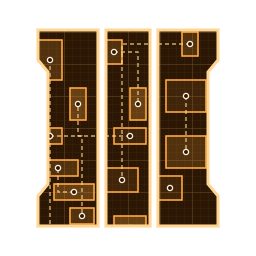
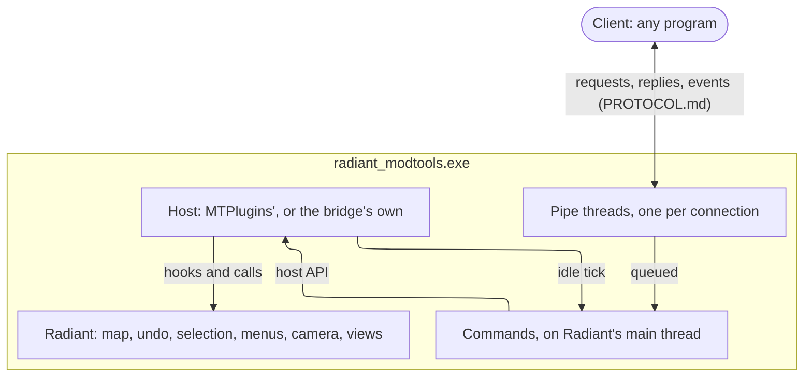

<div align="center">
    
    <h1>T7 Radiant Bridge</h1>
    <h3><em>Black Ops 3's Radiant, driven from another program, over a named pipe.</em></h3>
</div>

<p align="center">
    <a href="https://github.com/McReaper/t7_radiant_bridge/releases/latest"></a>
    <a href="https://github.com/McReaper/t7_radiant_bridge/actions/workflows/ci.yml"></a>
    <a href="LICENSE"></a>
    
    
</p>

<p align="center">
    <a href="#%EF%B8%8F-how-it-works">How it works</a> ·
    <a href="#-install">Install</a> ·
    <a href="#%EF%B8%8F-use">Use</a> ·
    <a href="#%EF%B8%8F-build">Build</a> ·
    <a href="#-releases">Releases</a> ·
    <a href="#-license">License</a>
</p>

A plugin for Radiant, Black Ops III's map editor, that lets another program drive it the way a mapper does: read the open map, edit it with undo, run Radiant's own commands, move the camera and capture the views. It serves a named-pipe protocol, [PROTOCOL.md](PROTOCOL.md), so any program on the same machine can be its client: an AI agent's tools, a script, a test. [T7 Companion](https://github.com/McReaper/t7_companion) is one, and ships the bridge to its users.

## ⚙️ How it works



- A client connects to `\\.\pipe\t7_radiant_bridge_<pid>`, says `hello`, then sends requests; several clients may be connected at once.
- The pipe threads only move bytes. Each request runs on Radiant's main thread, at the editor's idle tick, where its state is safe to read and change. The reply goes back on its connection, and events (console lines, map loads and saves) to the connections that asked for them.
- A host puts the plugin in Radiant and gives it the editor: MTPlugins' host, or the bridge's own standalone host (`host/`, forked from MTPlugins), which hooks Radiant itself. One host only ever runs in a Radiant: the standalone one steps aside when MTPlugins is there.

## 📥 Install

A release's `T7RadiantBridge-<version>.zip` holds both builds of the same plugin (`plugin/src/`):

- `T7RadiantBridge-<version>.dll`, the standalone bridge: inject it into a running Radiant, with `LoadLibraryW` from a remote thread once Radiant's main window exists. Nothing is written into the BO3 install. Its name carries its version, as a running Radiant keeps the one it loaded locked.
- `mtplugins/T7RadiantBridge/`, the MTPlugins plugin: where [MTPlugins](https://github.com/Aidan601/MTPlugins) runs, copy it into `<BO3 root>/bin/plugins/` and start Radiant. MTPlugins loads a new plugin on its own unless its `autoload_new` setting (`bin/plugins/RadiantPlugins.ini`) is 0; then tick it in MTPlugins' plugin list.

## ⌨️ Use

Speak [PROTOCOL.md](PROTOCOL.md) on the pipe: length-prefixed frames, a header line, then a body. `tools/t7rb`, a client in Go, is small enough to read as an example, and drives a running Radiant by hand:

```sh
t7rb state                                  # the open map, its entity count, the selection, any dialog
t7rb -body room.map import "my tool: room"  # map text pasted as one undo step
t7rb -png view.png capture 3d               # the 3D view's pixels
t7rb listen console map                     # the console and the map's events, as they come
```

## 🛠️ Build

`build.bat` builds both DLLs into `build/Release/` with Visual Studio's C++ tools and CMake, and runs the tests: the protocol's text, and the host's logic that needs no Radiant (menu paths, view projection, the exe check). CI does the same on every pull request and keeps the packed archive.

## 🚀 Releases

Set `kPluginVersion` in `plugin/src/version.h` (the standalone host reports the same version), then push the tag `v<version>`: the release workflow checks the two match, builds and tests, and publishes `T7RadiantBridge-<version>.zip`, laid out by `tools/package.ps1`. A command added to the protocol is marked in PROTOCOL.md with the version that brought it, so a client can require it.

```sh
git tag v1.2.0 && git push origin v1.2.0
```

## 📄 License

GPLv3, like MTPlugins, whose SDK header the plugin compiles and whose host the standalone build forks; MinHook, which the standalone host hooks with, is BSD-2. A client is a separate program talking over the pipe, under its own license. Third-party notices are in [NOTICE.md](NOTICE.md).
